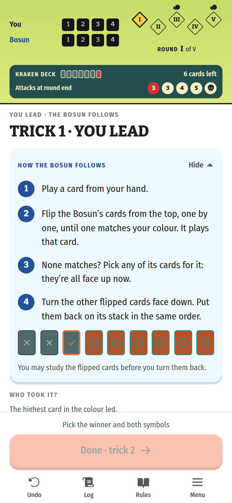
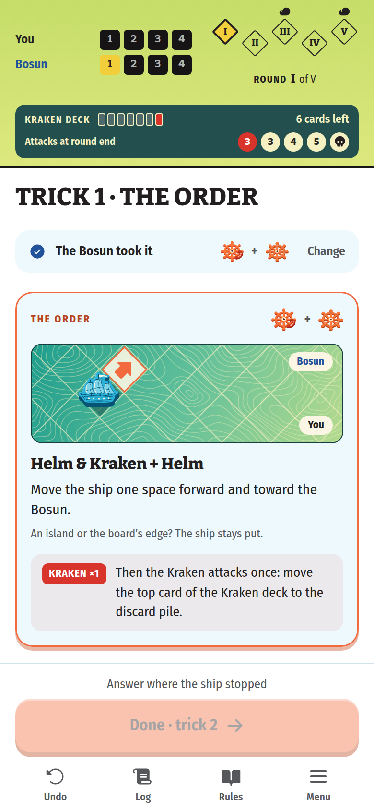
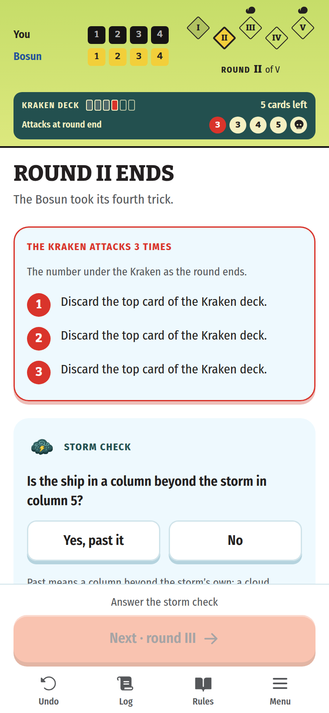

<h1 align="center">Bosun: play Sail solo</h1>

A phone-first web app (PWA) for playing the cooperative trick-taking game **Sail** alone, with
**Sail Solitaire**, Chuck Rosselli's fan solo variant. The Bosun takes the other side of the ship:
you flip its cards, and the app keeps the tricks, the Kraken and the storms.

It is a *companion* to the physical game, not a digital version. The board, the cards, the ship
and the Pirate cards stay on your table; the app stores only the symbols you tap.

<p align="center">
  <a href="docs/guide/README.md#3-a-trick"></a>
  <a href="docs/guide/README.md#4-the-order"></a>
  <a href="docs/guide/README.md#5-the-round-ends"></a>
</p>

> **Status:** in development. Work is planned in
> [issues](https://github.com/asilachev/sail-automa/issues) and
> [milestones](https://github.com/asilachev/sail-automa/milestones). The landing page will live at
> `bosun.silachev.com`, the app at `app.bosun.silachev.com`.

## What it does

- Runs the Bosun's side of Sail Solitaire: the exchange, following your colour, leading, and its
  Cannon + Wheel swap.
- Turns every pair of symbols into an order: where the ship goes and how often the Kraken attacks.
- Counts the Kraken deck, the round-end attacks, the storm checks, the rounds and who leads.
- Sets up any scenario from the Scenario Book, Learning to 5.
- Undo for every tap, saved after every tap, offline, installable, keeps the screen awake.
- English, Español, Deutsch, Русский and Српски.

## How to play

Set up Sail as the rulebook says, with the variant's changes, and let the app run the Bosun. Each
trick it tells you how the Bosun plays; you tap who took the trick and the two symbols, and it gives
you the order. It counts the Kraken deck and the attacks, and asks the storm checks. The
**[step-by-step guide](docs/guide/README.md)** walks through a whole voyage, screen by screen.

## Run it

You need Node 22 or later.

```sh
npm ci
npm run dev
```

Or run the published image: `docker run -p 8080:8080 ghcr.io/asilachev/sail-automa`, behind HTTPS
(install, offline mode and the wake lock need a secure context).

## Credits

- **Sail** by Akiyama Koryo and Kozu Yusei, illustrated by Weberson Santiago, published by
  [Allplay](https://allplay.com).
- **Sail Solitaire** by Chuck Rosselli, on BoardGameGeek.
- Fonts: Bitter and Fira Sans Condensed (SIL Open Font License). Icons: Phosphor (MIT).

Bosun is an unofficial fan app, not affiliated with Allplay. You need your own copy of Sail.

## License

The code is under the [MIT License](LICENSE). It doesn't cover the game Sail, its rules, names and
art, the Sail Solitaire variant, or the fonts and icons, which belong to their owners and keep
their own licences. The PDFs in `docs/reference/` belong to their authors.
