# How to play with the app

You play **Sail** on the table as usual, with **Sail Solitaire**: Chuck Rosselli's solo variant,
where a silent partner called **the Bosun** takes the other side of the ship. The app is the
Bosun's brain and your bookkeeper. It tells you how the Bosun plays each trick, turns every pair of
symbols into an order, counts the Kraken deck and the attacks, and asks the storm checks at the
right time.

You need the physical game and a phone. The app has no card data: after each trick you tap who
took it and the two symbols on the cards.

The app speaks English, Español, Deutsch, Русский and Српски. It starts in your phone's language;
change it with the **EN** button at the top of Home, or under **Settings → Language**.

**Contents**

1. [Start a voyage](#1-start-a-voyage)
2. [The exchange](#2-the-exchange)
3. [A trick](#3-a-trick)
4. [The order](#4-the-order)
5. [The round ends](#5-the-round-ends)
6. [The dock: undo, log, rules, menu](#6-the-dock-undo-log-rules-menu)
7. [How the voyage ends](#7-how-the-voyage-ends)
8. [Captain's log and settings](#8-captains-log-and-settings)

## 1. Start a voyage

1. On Home, tap **START YOUR FIRST VOYAGE**. Later, Home shows the voyage in progress instead,
   with **CONTINUE · ROUND N**: the voyage is saved after every tap.
2. **New voyage:**
   - **Scenario:** Learning or 1 to 5, from the Scenario Book.
   - **Your seat:** start on your left or your right, so the app's arrows point the way your ship
     sails.
   - **Difficulty** picks the Pirate cards (automa.md → The variant): **Easy** gives two shared
     Pirate cards, whoever wins the trick may use either; **Medium** gives one each, and the
     winner may use their own; **Hard** gives only you one.
   - **The Bosun's pirate:** switch it on if the Bosun has the Cannon + Wheel Pirate card, and the
     app walks you through its card swap.
   - **Rulings** (optional): the rulebooks and the variant leave five gaps. Each has a default; tap
     the row to read them and why (automa.md → Rulings).
3. Tap **NEXT · SET UP THE TABLE** and set up as the rulebook says, with the variant's changes,
   ticking each line as you do it: the scenario's tokens, the Kraken on the 3, the round disc on
   your side, the Kraken and player decks, and 9 cards for you and 9 face down for the Bosun's
   stack. Don't look at its cards.
4. Tap **SET SAIL**. It waits until every line is ticked; the note above it says how many are left.

<table>
  <tr>
    <td align="center" valign="top">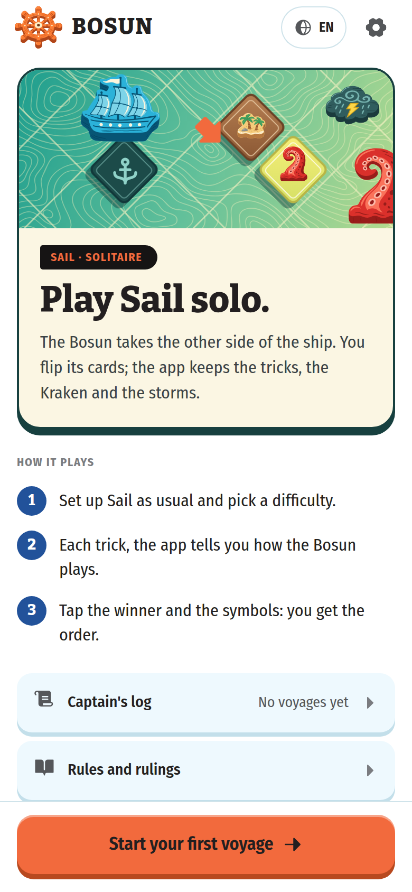 Home</td>
    <td align="center" valign="top">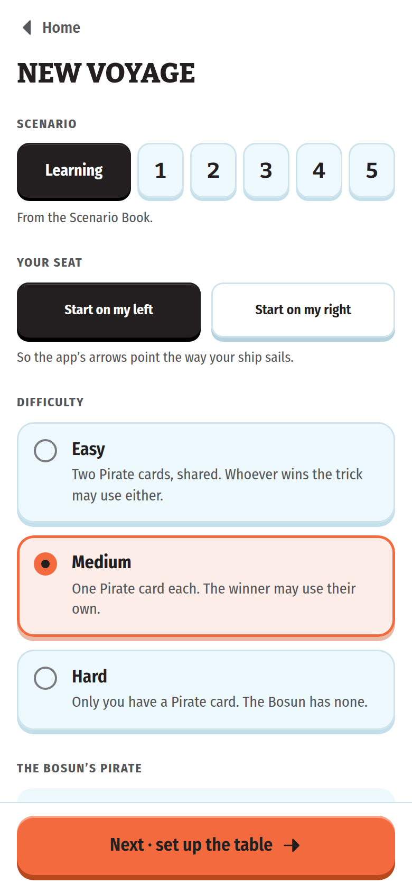 New voyage</td>
    <td align="center" valign="top">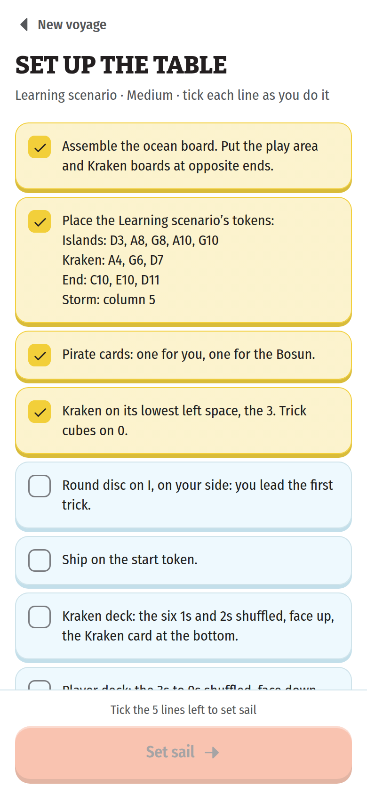 Set up the table</td>
  </tr>
</table>

## 2. The exchange

Every round starts with the exchange, and from then on nobody talks: the Bosun never does anyway.

1. Pick a card to give the Bosun and put it aside, face down.
2. Take the Bosun's top card into your hand.
3. Put your card face down on top of its stack. Now you know its first card.

Tap **EXCHANGE DONE · TRICK 1**.

The bar at the top stays there for the whole voyage: the tricks each side has taken this round, the
round out of V, how many cards are left in the Kraken deck and the attacks at each round end. The
clouds on the round track mark the storms.

<table>
  <tr>
    <td align="center" valign="top">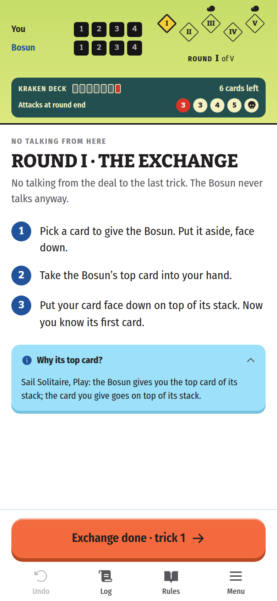 The exchange</td>
  </tr>
</table>

## 3. A trick

**You lead** the first trick in rounds I, III and V; **the Bosun leads** in rounds II and IV. After
that, whoever took the last trick leads (automa.md → The variant).

- **You lead:** play a card from your hand. Then flip the Bosun's cards from the top, one by one,
  until one matches your colour: it plays that card. If none matches, pick any of its cards for
  it. Turn the other flipped cards face down and put them back on its stack in the same order. You
  may study them before you do.
- **The Bosun leads:** flip its top card; it leads with it. Play a card, following its colour if
  you can.

The highest card in the colour led takes the trick. Once you know the steps, tap **Hide** to fold
them away; tap the line again to open them.

Then tell the app what happened: **who took it**, **your card's symbol** and **the Bosun's**. Tap
**DONE · TRICK N**; it waits for all three.

<table>
  <tr>
    <td align="center" valign="top">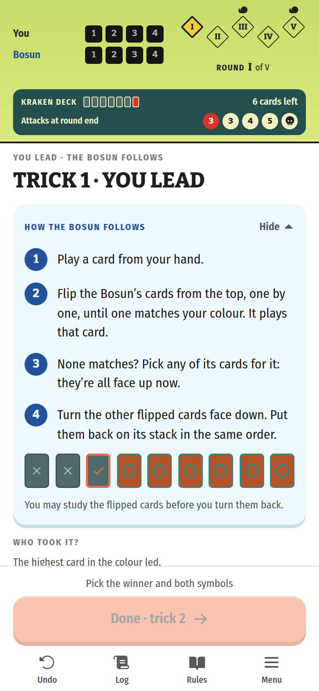 You lead</td>
    <td align="center" valign="top">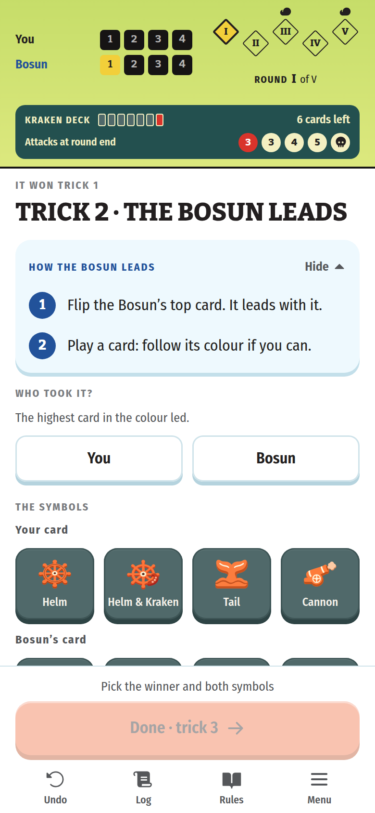 The Bosun leads</td>
    <td align="center" valign="top">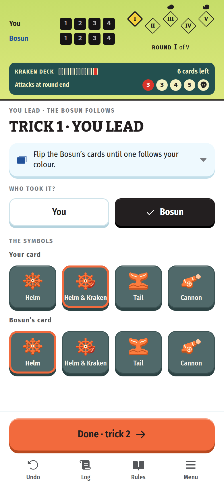 Who took it, and the symbols</td>
  </tr>
</table>

## 4. The order

The two symbols make the order (rules.md → Actions). The app shows the move on a small map, from
the side of the trick's winner, and what the Kraken does:

- **Helm + Helm:** one space forward and toward the winner.
- **Helm & Kraken + Helm:** the same move, then the Kraken attacks once; **+ Helm & Kraken**, twice.
  It attacks even if the ship couldn't move.
- **Helm & Kraken + Cannon:** a hit on the Kraken. The Helm & Kraken card goes under the Kraken
  deck instead of the discard pile.
- **Tail + Tail:** one space straight forward.
- **Cannon + Cannon:** flip the top card of the player deck and tap its symbol. Helm moves toward
  the winner, Helm & Kraken goes under the Kraken deck, Tail moves straight, and a Cannon flips
  another card.
- Anything else: no action, no attack.

For each attack, move the top card of the Kraken deck to the discard pile. If the Kraken card is on
top, the app says so: move the Kraken one space clockwise and put its card at the bottom.

When the ship moves, answer **Did the ship move onto a token?** An island or the board's edge
stops the ship, and that's a **No**. A **Kraken token** adds one attack, the **End token** wins at
once, and sailing **past the End token** loses (ruling 1).

Tapped the wrong winner or symbol? Tap **Change** at the top. When the winner may use a Pirate
card, the app reminds you; for the Bosun, you decide (ruling 2). If a Pirate card changed the Kraken
deck, tap **Fix the trackers**. Tap **DONE · TRICK N** when the order is done at the table.

<table>
  <tr>
    <td align="center" valign="top">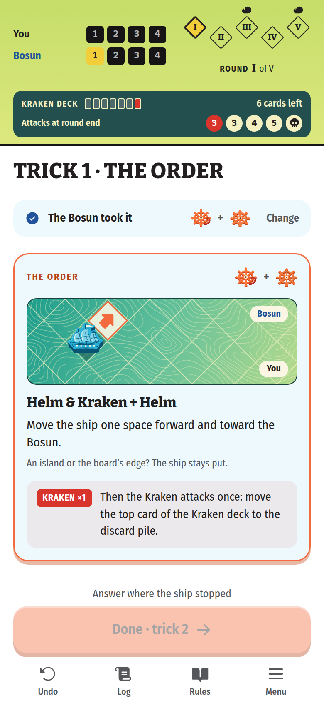 The order</td>
    <td align="center" valign="top">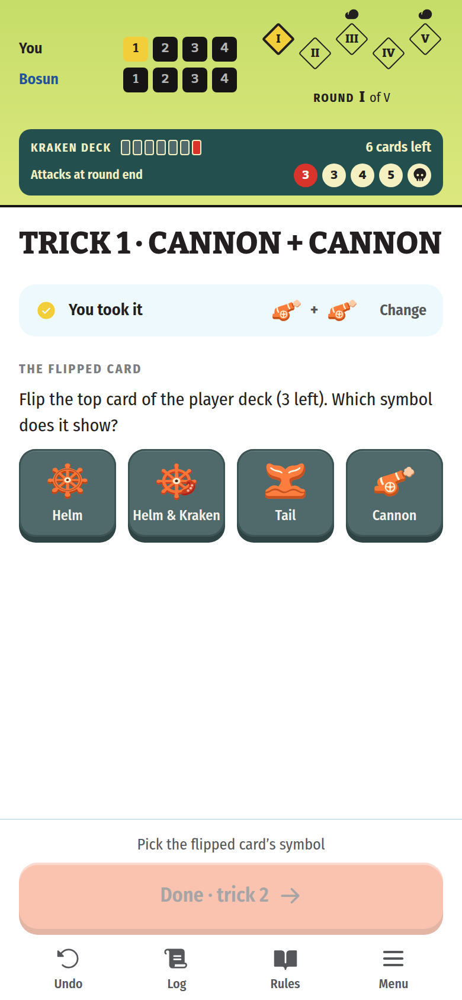 Cannon + Cannon</td>
  </tr>
</table>

## 5. The round ends

The round ends when someone takes their fourth trick (rules.md → A round). The Kraken attacks as
many times as the number under it on the Kraken track: **3, 3, 4, 5**, then the skull. The app lists
each attack, and says when the Kraken card comes up and the attacks go up.

After rounds II and IV there's a **storm check** (only after round II in the Learning scenario).
The ship must be in a column beyond the storm's own: tap **YES, PAST IT** or **NO**. A cloud spilling
into the next column doesn't count. Then tap **NEXT · ROUND N**.

The **new deal** comes next: shuffle the player deck, the discard pile and both hands together
(the Kraken deck stays), deal 9 to yourself and 9 face down to the Bosun's stack, and move the
trick cubes back to 0 and the round disc on. Tap **DEALT · THE EXCHANGE**.

<table>
  <tr>
    <td align="center" valign="top">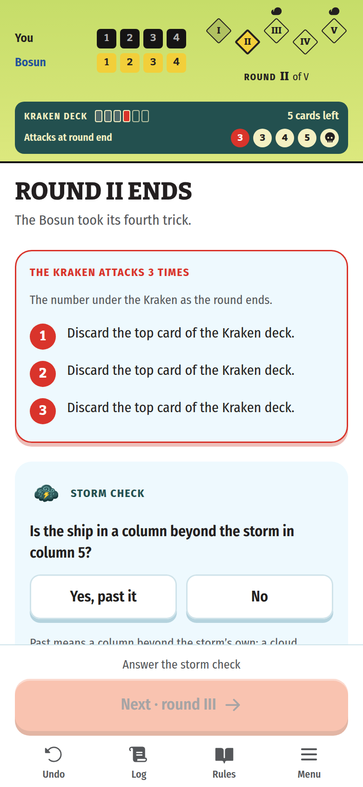 Round end and the storm check</td>
    <td align="center" valign="top">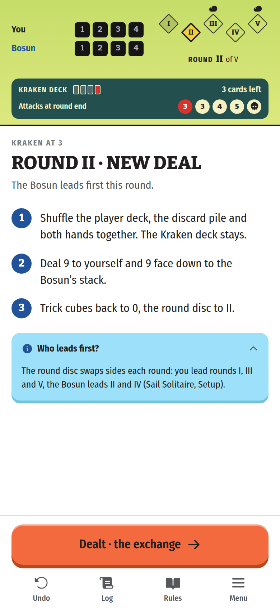 The new deal</td>
  </tr>
</table>

## 6. The dock: undo, log, rules, menu

The bar at the bottom is there for the whole voyage.

- **Undo** takes back the last tap, and a toast says what was undone, with **Undo more**. You can
  undo all the way back to the exchange.
- **Log** is the ship's log: every trick, order, round end and fix, newest first.
- **Rules** shows the combos at a glance, and what a flipped card does on Cannon + Cannon.
- **Menu** starts with **Back to home** (the voyage stays saved) and **End this voyage**. Below them:
  the combos, this voyage's rulings, the ship's log, **Fix the trackers**, keep the screen awake,
  language, theme and the credits.

**Fix the trackers** is for when the table and the app disagree, say after a Pirate card: set the
cards above and below the Kraken card, the attacks at round end and the cards in the player deck,
and tap **SAVE FIXES**. The fix goes into the ship's log, and Undo takes it back like any tap.

<table>
  <tr>
    <td align="center" valign="top">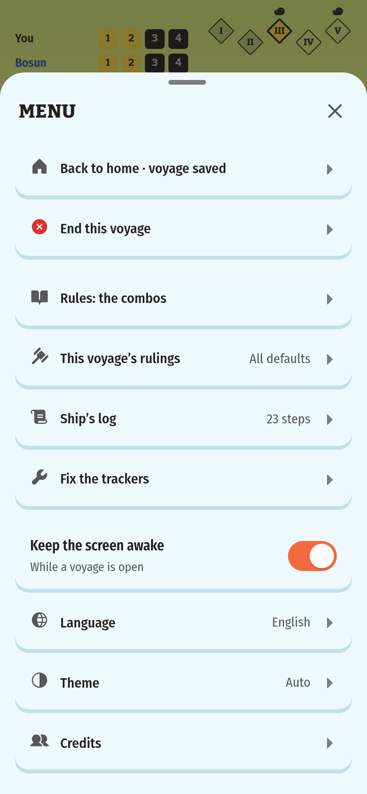 Menu</td>
    <td align="center" valign="top">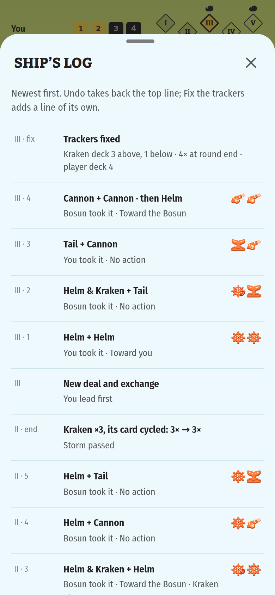 Ship's log</td>
    <td align="center" valign="top">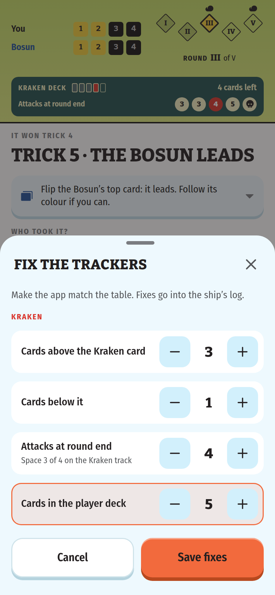 Fix the trackers</td>
  </tr>
</table>

## 7. How the voyage ends

**You win** as soon as the ship sails onto an End token, even if the same order would also lose
(rules.md → Winning and losing).

**The Kraken wins** if:

- the ship is still behind the storm at a storm check;
- only the Kraken card is left in the Kraken deck;
- the Kraken reaches the skull;
- round V ends;
- the ship sails past the End token (ruling 1's default).

The end screen shows the rounds, the tricks and the Kraken, and the voyage is already in the
captain's log. Tap **NEW VOYAGE** or **TRY SCENARIO N AGAIN** to play again.

To stop a voyage early, tap **End this voyage** in the menu or on Home. The app asks first: the
saved voyage is cleared and goes into the captain's log as unfinished. To pause instead, tap
**Back to home**, or just close the app; **CONTINUE** picks it up again.

<table>
  <tr>
    <td align="center" valign="top">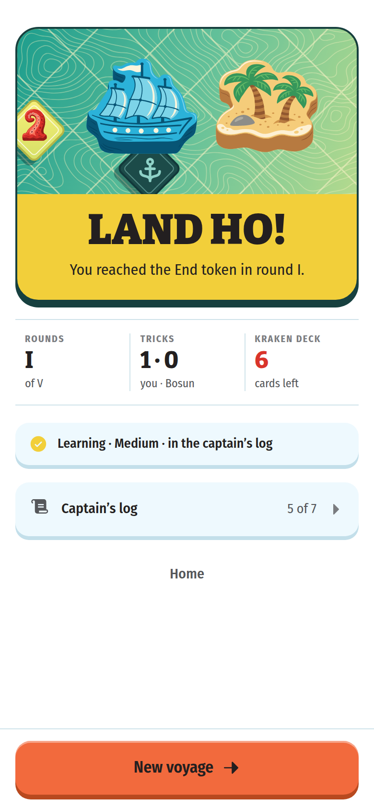 Land ho</td>
    <td align="center" valign="top">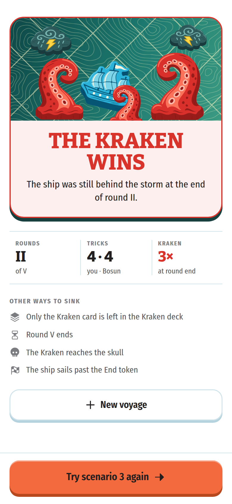 The Kraken wins</td>
  </tr>
</table>

## 8. Captain's log and settings

Every voyage that ends goes into the **captain's log** on Home: your voyages, how many reached
land and your win rate, a grid of every scenario at every difficulty (gold where you reached land,
otherwise how many tries), and the recent voyages. **Clear the log** at the bottom empties it.

**Settings** (the gear on Home) has the language, the theme (Auto follows your phone; Day and
Night pin it), keep the screen awake, the credits and the source code. No account, no tracking:
your voyages stay on your phone.

Installing is optional, but then the app runs full screen, works offline and keeps the screen
awake. On iPhone, open it in Safari, tap **Share**, then **Add to Home Screen**; on Android and
desktop Chrome, tap **Install** on the card on Home.

<table>
  <tr>
    <td align="center" valign="top">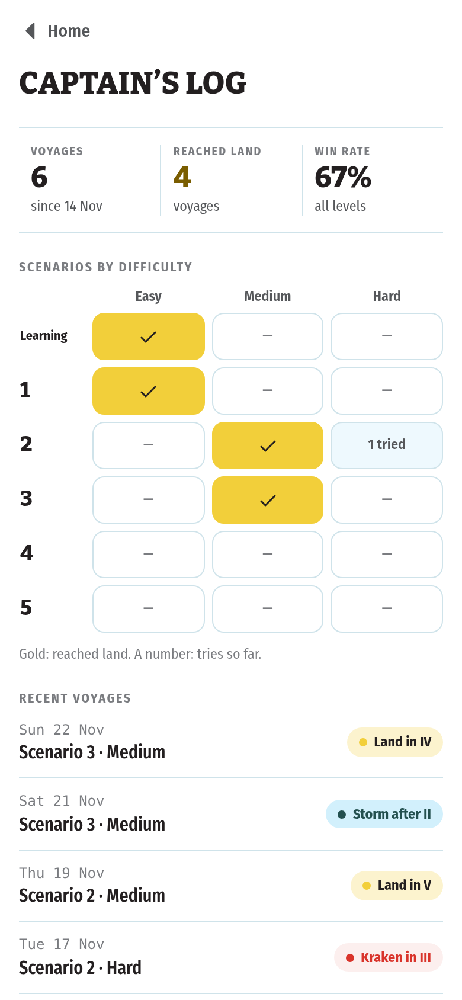 Captain's log</td>
    <td align="center" valign="top">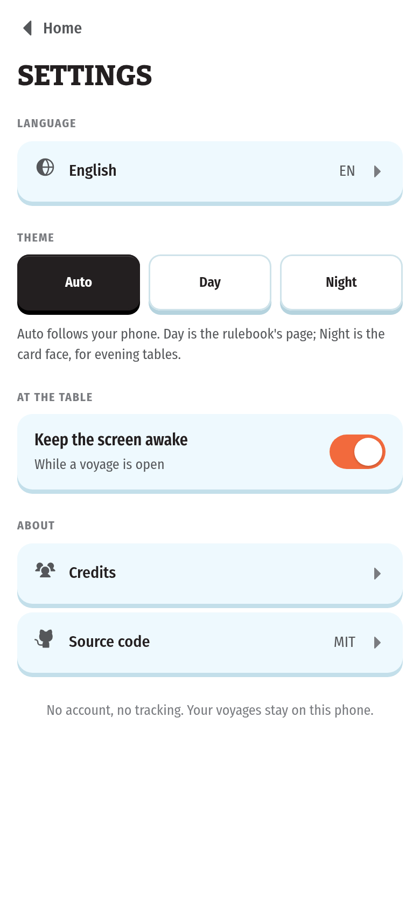 Settings</td>
  </tr>
</table>

## About the screenshots

Every screenshot is exactly **780 × 1688 pixels**: a 390 × 844 phone screen at 2×.
`npm run shots` builds the app and captures them all again in Chrome, from voyages built with the
engine's fixture scripts (`scripts/screenshots.mjs`). It fails if any image has a different size.

## Credits

Sail is by Akiyama Koryo and Kozu Yusei, illustrated by Weberson Santiago and published by Allplay.
Sail Solitaire is by Chuck Rosselli, on BoardGameGeek. Bosun is an unofficial fan app; see the
[main README](../../README.md#credits).
